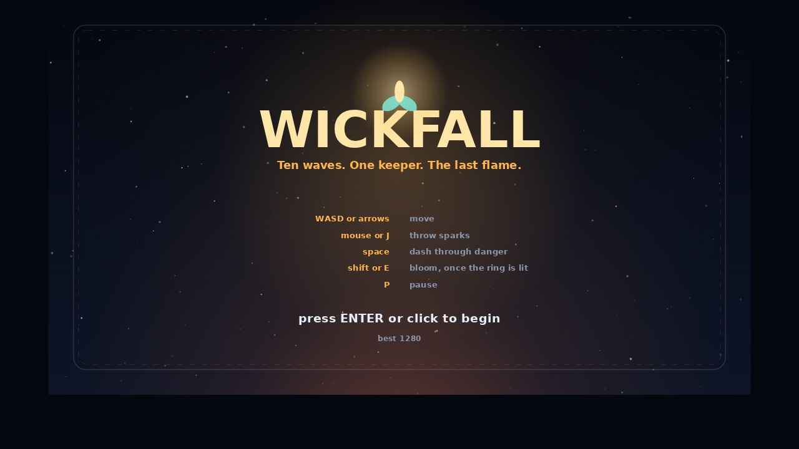

# Wickfall

[](https://make.fun/bounty/best-game-01)
[](https://make.fun/bounty/best-game-01)
[](https://make.fun/bounty/best-game-01)

An entry in [Make the best game](https://make.fun/bounty/best-game-01) on make.fun.

A moth carries the last flame through ten waves of the dark. It throws sparks, dashes through
danger, and blooms light once its meter fills with motes. Between waves it drafts one of three
boons that change the numbers it fights with. A run lasts about two minutes and ends either in a
win, all ten waves held, or a loss — with a score either way.



## Play it

Nothing to install and nothing to fetch: the game is plain ES modules and one `<canvas>`, with no
library, no build step and no network request. Node 22.18 or later is enough to serve it.

```
node serve.ts
```

Then open http://localhost:8080. `serve.ts` is a static file server for this folder only; any
static server pointed at `game/` works the same way, and so does opening `game/index.html` through
one, because the modules are relative.

Controls:

| Key | Action |
| --- | --- |
| `W` `A` `S` `D` or arrows | Move |
| Mouse | Aim |
| Left click, or `Space` held | Throw sparks |
| `Shift` or `E` | Bloom, once the meter is full |
| `P` or `Esc` | Pause |
| `R` | Restart |
| `1` `2` `3` | Take a boon when one is offered |

The mouse aims and left click fires; the keyboard alone can play the whole game too, since sparks
fly toward the direction the keeper is moving and `Space` fires.

## What is in here

```
game/index.html        the canvas, the live region, and nothing else
game/src/config.js     every tunable in one place: sizes, speeds, waves, palette
game/src/random.js     a seeded PRNG, so a seed and a step count replay a run exactly
game/src/world.js      the whole simulation, with no DOM and no canvas in it
game/src/enemies.js    the enemy recipes and the ten waves that spawn them
game/src/boons.js      the boons, as data that modifies the keeper's stats
game/src/render.js     drawing, from the state alone
game/src/input.js      keyboard and pointer, normalised into one shape
game/src/audio.js      short synthesised cues, silent if the browser refuses audio
game/src/main.js       boot, the fixed-step loop, and the screenshots' scenes
serve.ts               a static server for the folder
main.ts                the entry's program: writes /output/game, /output/screenshots and dossier.json
screenshots/           four frames, each one a scene a seed reaches in real play
```

## Reproducible by construction

The simulation is a fixed-step loop at `STEP = 1/60`, every random draw comes from a mulberry32
PRNG seeded from `?seed=`, and `world.js` reaches for neither the clock nor `Math.random`. Two runs
of the same seed with the same input therefore produce byte-identical state; the screenshots are
not painted by hand but captured from the running simulation at a named seed and step count:

| Screenshot | Scene |
| --- | --- |
| `1-start.jpg` | `?shot=start&seed=1` — the title screen |
| `2-play.jpg` | `?shot=play&seed=1` — mid-fight, a warden on screen |
| `3-boons.jpg` | `?shot=boons&seed=1` — the draft after the fifth wave falls |
| `4-end.jpg` | `?shot=end&seed=99` — a real loss in the tenth wave |

`shots.json` lists them in the form the grader reads.

## The entry program

`main.ts` is what the competition's runtime runs. It copies `game/` and `screenshots/` beside it to
`/output` and writes `/output/dossier.json` with the vendored `vendor/makefun-game.ts`, which
enforces the scorer's own caps on the way out. Outside the grader's container, point
`MAKEFUN_OUTPUT_DIR` somewhere writable:

```
mkdir -p out && MAKEFUN_OUTPUT_DIR=out node main.ts
```

## Licence

MIT. See `LICENSE`.
